# expedition-contrib

Your GitHub contribution calendar as an isometric pixel-art shoot-'em-up, in the style of
[Expedition](https://github.com/Zeyadmosalem/Expedition). It replaces the classic
"snake eats your contributions" animation.

<picture>
  <source media="(prefers-color-scheme: dark)" srcset="preview/expedition-contrib-dark.svg">
  
</picture>

<sub>Preview made from the sample calendar in `tests/fixtures/calendar.json`.</sub>

Every day of the last year is an isometric floor tile. Each day with contributions is a raised
block, and busier days are taller and brighter. The skull hero walks the catwalk along the
front edge and fires a bolt up every week that has blocks. Each block it hits bursts into
particles, like a killed alien. When the hero reaches the last week, the grid rebuilds and the
loop starts again. The hero dashes through empty weeks, so a sparse year still loops quickly.

- One animated SVG per color scheme (light and dark), so it matches the visitor's GitHub theme.
- CSS animation only. There's no JavaScript, so it plays inside GitHub's `` sandbox.
  Visitors who prefer reduced motion get a still frame.
- The generator uses only the Python standard library. The hero's head is the Expedition skull
  logo, reduced to a 15 px 3-colour sprite with a 1 px dark outline.

## Put it on your profile

A GitHub Action in this repo renders the SVGs every day and commits them to the `output`
branch. Paste this into your profile README (`<user>/<user>/README.md`) in place of the snake image:

```html
<picture>
  <source media="(prefers-color-scheme: dark)" srcset="https://raw.githubusercontent.com/Zeyadmosalem/expedition-contrib/output/expedition-contrib-dark.svg">
  <source media="(prefers-color-scheme: light)" srcset="https://raw.githubusercontent.com/Zeyadmosalem/expedition-contrib/output/expedition-contrib.svg">
  
</picture>
```

To use it for another account, fork this repo and replace `Zeyadmosalem` in the URLs with your
login. The workflow draws the repository owner's calendar by default. To draw a different
account, set a repository variable named `CONTRIB_USER`.

## How the update works

`.github/workflows/update.yml` runs every day at 04:23 UTC. It also runs when you trigger it
from the Actions tab and when the generator changes on `main`. Each run:

1. runs the tests,
2. queries the GraphQL API (`user.contributionsCollection.contributionCalendar`) with the
   built-in `GITHUB_TOKEN`, so no personal token or secret is needed,
3. renders `expedition-contrib.svg` and `expedition-contrib-dark.svg`,
4. force-pushes them as the only commit on the `output` branch.

GitHub turns off scheduled workflows in a public repo after 60 days without activity. If that
happens, re-enable the workflow from the Actions tab.

## Run it locally

```bash
python -m contrib_blaster --user Zeyadmosalem --input tests/fixtures/calendar.json --out preview
```

To render from live data, put a token in the environment. The token is only sent in the API
request's `Authorization` header and is never written to disk:

```bash
GITHUB_TOKEN=$(gh auth token) python -m contrib_blaster --user Zeyadmosalem --out dist
```

Open `preview/index.html` through any static server, for example `python -m http.server`, to see
both themes the way GitHub shows them.

Tests:

```bash
python -m unittest discover -s tests -v
```

## Layout

| Path | What it does |
| --- | --- |
| `contrib_blaster/contributions.py` | GraphQL query, response parsing, weekday rows and levels |
| `contrib_blaster/pixels.py` | Pixel rasters: skull hero, gun, isometric blocks (lit top plus two shaded faces) |
| `contrib_blaster/render.py` | Scene layout, shot timeline and the animated SVG |
| `tests/` | Fixture calendar and tests for parsing, the SVG structure and the timeline |
