# expedition-contrib

Your GitHub contribution calendar as an isometric pixel-art platformer, in the style of
[Expedition](https://github.com/Zeyadmosalem/Expedition). It replaces the classic
"snake eats your contributions" animation.

<picture>
  <source media="(prefers-color-scheme: dark)" srcset="preview/expedition-contrib-dark.svg">
  
</picture>

<sub>Preview made from the sample calendar in `tests/fixtures/calendar.json`.</sub>

Every day of the last year is an isometric floor tile. Each day with contributions is a raised
block, and busier days are taller and brighter. The skull hero hops across the year, one hop
per week, onto that week's tallest block, so it climbs and drops with your weekly peaks. Each
block it lands on squashes, pops a spinning coin and lights up, and the rest of that week
bounces. Empty weeks get a quick hop along the floor. After the last week a flag pops up on
your busiest day, the hero does a victory hop and warps out, the lights fade and the loop
starts again.

- One animated SVG per color scheme (light and dark), so it matches the visitor's GitHub theme.
- CSS animation only. There's no JavaScript, so it plays inside GitHub's `` sandbox.
  Visitors who prefer reduced motion get a still frame.
- The generator uses only the Python standard library. Pillow is needed only for a picture head.
  The default hero's head is the Expedition skull logo, reduced to a 15 px 3-colour sprite with a
  1 px dark outline. You can swap in your own picture and suit colours (see
  [Customize the hero](#customize-the-hero)).

## Put it on your profile

A GitHub Action in this repo renders the SVGs every day and commits them to the `output`
branch. Paste this into your profile README (`<user>/<user>/README.md`) in place of the snake image:

```html
<picture>
  <source media="(prefers-color-scheme: dark)" srcset="https://raw.githubusercontent.com/Zeyadmosalem/expedition-contrib/output/expedition-contrib-dark.svg">
  <source media="(prefers-color-scheme: light)" srcset="https://raw.githubusercontent.com/Zeyadmosalem/expedition-contrib/output/expedition-contrib.svg">
  
</picture>
```

To use it for another account, fork this repo and replace `Zeyadmosalem` in the URLs with your
login. The workflow draws the repository owner's calendar by default. To draw a different
account, set a repository variable named `CONTRIB_USER`.

## Customize the hero

Edit [`character.toml`](character.toml) and commit it. The workflow redraws the animation on
that push.

```toml
head = "skull"      # the Expedition skull, or a picture: head = "character.png"
suit = "#24263e"    # suit
light = "#de3442"   # chest light
```

- **Colours** are hex codes. The lit edge of the suit is derived from the suit colour. An old
  `gun` setting from the blaster version is still accepted and ignored.
- **Picture head:** this works like Expedition's CHARACTER photo option. The picture is cropped
  to a centred square, shrunk to a 16 px round head, posterized to a small palette and outlined.
  PNG, JPEG and WebP all work, and the path is relative to `character.toml`.
- **Keep your photo private:** this repo is public, so any picture you commit here is published.
  To publish only the tiny pixel head, make it on your own computer first (this needs Pillow,
  `pip install pillow`), then commit just `character.png`:

  ```bash
  python -m contrib_hopper.character my-photo.jpg character.png
  ```

  Then set `head = "character.png"`.

Locally, the generator reads `character.toml` from the current folder. To use a different file,
pass `--character other.toml`.

## How the update works

`.github/workflows/update.yml` runs every day at 04:23 UTC. It also runs when you trigger it
from the Actions tab, and on pushes to `main` that change the generator, `character.toml` or a
picture in the repo root. Each run:

1. runs the tests,
2. queries the GraphQL API (`user.contributionsCollection.contributionCalendar`) with the
   built-in `GITHUB_TOKEN`, so no personal token or secret is needed,
3. renders `expedition-contrib.svg` and `expedition-contrib-dark.svg`,
4. force-pushes them as the only commit on the `output` branch.

GitHub turns off scheduled workflows in a public repo after 60 days without activity. If that
happens, re-enable the workflow from the Actions tab.

## Run it locally

```bash
python -m contrib_hopper --user Zeyadmosalem --input tests/fixtures/calendar.json --out preview
```

To render from live data, put a token in the environment. The token is only sent in the API
request's `Authorization` header and is never written to disk:

```bash
GITHUB_TOKEN=$(gh auth token) python -m contrib_hopper --user Zeyadmosalem --out dist
```

Open `preview/index.html` through any static server, for example `python -m http.server`, to see
both themes the way GitHub shows them.

Tests:

```bash
python -m unittest discover -s tests -v
```

## Layout

| Path | What it does |
| --- | --- |
| `contrib_hopper/contributions.py` | GraphQL query, response parsing, weekday rows and levels |
| `contrib_hopper/route.py` | The hop route and timing: one hop per week onto the tallest block, flag day, loop length |
| `contrib_hopper/pixels.py` | Pixel rasters: skull hero (stand and jump poses), coin, flag, isometric blocks and lit tops |
| `contrib_hopper/render.py` | Scene layout and the animated SVG (CSS keyframes for hops, squashes, coins and lights) |
| `contrib_hopper/character.py` | Hero settings from `character.toml`, and picture-to-pixel-head conversion |
| `tests/` | Fixture calendar and tests for parsing, the route, the sprites and the SVG |
