# Block Hopper Implementation Plan

> **For agentic workers:** REQUIRED SUB-SKILL: Use superpowers:subagent-driven-development (recommended) or superpowers:executing-plans to implement this plan task-by-task. Steps use checkbox (`- [ ]`) syntax for tracking.

**Goal:** Replace the blaster animation with Block Hopper: the skull hero hops across the contribution year, one hop per week onto the week's tallest block, lighting blocks up and popping coins.

**Architecture:** A new pure-maths module `route.py` decides where and when the hero hops (a `Timeline` of `Hop`s). `render.py` turns that timeline into CSS keyframes: two nested hero groups (`hx` ground motion, `hy` eased arc), per-block squash/bounce and lit-top keyframes, shared coin keyframes. `pixels.py` gains the new sprites. The package is renamed `contrib_blaster` → `contrib_hopper`.

**Tech Stack:** Python 3.12 (CI) / 3.11+ (needs `tomllib`), standard library only (Pillow only for picture heads), `unittest`, hand-written SVG + CSS animation.

**Spec:** `docs/superpowers/specs/2026-11-17-block-hopper-design.md`

## Global Constraints

- Generator uses only the Python standard library; Pillow is needed only to read a picture head.
- Animation is CSS only: no `<script>`, no `on*=` attributes (must play inside GitHub's `` sandbox).
- Output filenames stay `expedition-contrib.svg` (light) and `expedition-contrib-dark.svg` (dark).
- Visitors with `prefers-reduced-motion: reduce` get a still frame.
- Isometric geometry is unchanged: `tile_xy(w, d) = ((w + d) * 8, (w - d) * 4)`, `HEIGHTS = (2, 4, 7, 10, 14)`.
- Line endings LF (`.gitattributes` has `* text=auto eol=lf`).
- Run tests from the repo root: `python -m unittest discover -s tests -v`.
- Every commit message ends with the line `Co-Authored-By: Claude Opus 5.5 <noreply@anthropic.com>`.
- Work happens on branch `block-hopper` in `C:\Users\DELL\Desktop\Projects\expedition-contrib`.

Deliberate refinements of the spec (same behaviour, better boundaries):
- `plan()`, `Hop`, `Timeline` and the geometry helpers live in a new `contrib_hopper/route.py` (no SVG there), re-exported from `render.py`, instead of inside `render.py`.
- `Timeline` also carries `victory: Hop` (the in-place hop after the last week).
- The coin is the same gold in both themes (`pixels.COIN_COLORS`); themes gain `lit` and `flag` colours.

---

### Task 1: Rename the package to `contrib_hopper`

No behaviour change; every existing test must still pass.

**Files:**
- Move: `contrib_blaster/` → `contrib_hopper/`
- Modify: `contrib_hopper/__main__.py`, `contrib_hopper/character.py` (docstrings/usage), `tests/test_blaster.py`, `tests/test_character.py`, `.github/workflows/update.yml`, `README.md`

**Interfaces:**
- Produces: package `contrib_hopper` with the same modules (`contributions`, `pixels`, `render`, `character`, `__main__`).

- [ ] **Step 1: Move the package with git**

```bash
cd /c/Users/DELL/Desktop/Projects/expedition-contrib
git mv contrib_blaster contrib_hopper
```

- [ ] **Step 2: Replace every reference to the old name**

```bash
grep -rl contrib_blaster --exclude-dir=.git --exclude-dir=dist --exclude-dir=docs . \
  | xargs sed -i 's/contrib_blaster/contrib_hopper/g'
grep -rn contrib_blaster --exclude-dir=.git --exclude-dir=dist --exclude-dir=docs . || echo "no references left"
```

Expected: `no references left`. The workflow now has `- "contrib_hopper/**"` under `paths:` and `python -m contrib_hopper --user ...`.

- [ ] **Step 3: Run the tests**

Run: `python -m unittest discover -s tests -v`
Expected: `Ran 28 tests ... OK`

- [ ] **Step 4: Commit**

```bash
git add -A
git status --short     # only renames under contrib_hopper/ plus edits to tests/, .github/, README.md
git commit -m "Rename the package to contrib_hopper" -m "Co-Authored-By: Claude Opus 5.5 <noreply@anthropic.com>"
```

---

### Task 2: Route and timing (`route.py`)

**Files:**
- Create: `contrib_hopper/route.py`
- Test: `tests/test_route.py`

**Interfaces:**
- Consumes: `contributions.Calendar(login: str, total: int, days: tuple[Day, ...])`, `contributions.Day(date, count, level, week, weekday)`, `Calendar.weeks`, `Calendar.active`.
- Produces (used by Task 4):
  - constants `HEIGHTS, LANE_D, START_W, NO_LANDING, INTRO, HOP, HOP_PER_LEVEL, FLOOR_HOP, PAUSE, VICTORY, OUTRO, HOLD, FADE, APEX, APEX_PER_LEVEL, VICTORY_APEX`
  - `tile_xy(w: float, d: float) -> tuple[float, float]`, `ground(w: float, d: float) -> tuple[float, float]`, `lift(level: int) -> int`
  - `Hop(week: int, weekday: int, level: int, takeoff: float, land: float, apex: int)` (frozen dataclass)
  - `Timeline(hops: tuple[Hop, ...], victory: Hop, flag_day: tuple[int, int, int], hop_end: float, reset_start: float, period: float)` (frozen dataclass)
  - `plan(cal: Calendar) -> Timeline` (raises `ValueError` if the calendar has no days)

- [ ] **Step 1: Write the failing tests**

Create `tests/test_route.py`:

```python
"""Tests for the Block Hopper route and timing (contrib_hopper.route)."""
from __future__ import annotations

import json
import unittest
from pathlib import Path

from contrib_hopper import contributions
from contrib_hopper import route as RT
from contrib_hopper.contributions import Calendar, Day

FIXTURE = Path(__file__).parent / 'fixtures' / 'calendar.json'


def make_cal(levels: dict, weeks: int, weekdays=range(7)) -> Calendar:
    """Synthetic calendar: levels maps (week, weekday) -> level; count = 3 * level."""
    days = []
    for w in range(weeks):
        for d in weekdays:
            lv = levels.get((w, d), 0)
            days.append(Day(f'2026-w{w:02d}-{d}', lv * 3, lv, w, d))
    return Calendar('t', sum(x.count for x in days), tuple(days))


TIES = make_cal({(0, 1): 2, (0, 5): 2, (1, 2): 3, (1, 6): 3, (3, 0): 1}, weeks=4)


class RouteTests(unittest.TestCase):
    def test_one_hop_per_week_in_order(self):
        tl = RT.plan(TIES)
        self.assertEqual([h.week for h in tl.hops], [0, 1, 2, 3])

    def test_targets_and_tie_breaks(self):
        # week 0: level-2 at weekdays 1 and 5, both 2 away from 3 -> lower weekday 1
        # week 1: level-3 at 2 and 6, nearest to 1 -> 2
        # week 2: empty -> floor at the previous weekday 2
        # week 3: only (3, 0) -> weekday 0
        tl = RT.plan(TIES)
        self.assertEqual([(h.week, h.weekday, h.level) for h in tl.hops],
                         [(0, 1, 2), (1, 2, 3), (2, 2, 0), (3, 0, 1)])

    def test_hop_durations(self):
        tl = RT.plan(TIES)
        durations = [h.land - h.takeoff for h in tl.hops]
        expected = [RT.HOP + RT.HOP_PER_LEVEL * n for n in (2, 1, 3, 1)]
        for got, want in zip(durations, expected):
            self.assertAlmostEqual(got, want)
        floor = RT.plan(make_cal({}, weeks=3))
        for h in floor.hops:
            self.assertAlmostEqual(h.land - h.takeoff, RT.FLOOR_HOP)

    def test_apex_clears_both_ends(self):
        tl = RT.plan(TIES)
        self.assertEqual(tl.hops[0].apex, 19)      # floor -> level 2: lift 5 + 10 + 2 per level climbed
        self.assertEqual(tl.hops[2].apex, 18)      # level 3 -> floor: lift 8 + 10, no climb bonus
        prev = 0
        for h in tl.hops:
            self.assertGreater(h.apex, max(RT.lift(prev), RT.lift(h.level)))
            prev = h.level

    def test_timeline_is_ordered(self):
        tl = RT.plan(TIES)
        self.assertAlmostEqual(tl.hops[0].takeoff, RT.INTRO)
        for a, b in zip(tl.hops, tl.hops[1:]):
            self.assertLess(a.takeoff, a.land)
            self.assertAlmostEqual(b.takeoff, a.land + RT.PAUSE)
        v = tl.victory
        self.assertEqual((v.week, v.weekday, v.level), (3, 0, 1))
        self.assertAlmostEqual(v.takeoff, tl.hops[-1].land + RT.PAUSE)
        self.assertAlmostEqual(v.land, v.takeoff + RT.VICTORY)
        self.assertEqual(v.apex, RT.lift(1) + RT.VICTORY_APEX)
        self.assertEqual(tl.hop_end, tl.hops[-1].land)
        self.assertAlmostEqual(tl.reset_start, v.land + RT.OUTRO + RT.HOLD)
        self.assertAlmostEqual(tl.period, tl.reset_start + RT.FADE)

    def test_flag_on_busiest_day_latest_date_wins_ties(self):
        # (1, 2) and (1, 6) both have the top count 9; '2026-w01-6' is the later date
        self.assertEqual(RT.plan(TIES).flag_day, (1, 6, 3))

    def test_empty_calendar_hops_the_floor(self):
        tl = RT.plan(make_cal({}, weeks=3))
        self.assertEqual([(h.weekday, h.level) for h in tl.hops], [(3, 0)] * 3)
        self.assertEqual(tl.flag_day, (2, 3, 0))

    def test_partial_week_floor_hop_uses_an_existing_weekday(self):
        tl = RT.plan(make_cal({}, weeks=1, weekdays=range(4, 7)))
        self.assertEqual(tl.hops[0].weekday, 4)

    def test_no_days_is_an_error(self):
        with self.assertRaisesRegex(ValueError, 'no days'):
            RT.plan(Calendar('t', 0, ()))

    def test_fixture_year(self):
        cal = contributions.parse(json.loads(FIXTURE.read_text(encoding='utf-8')), 'tester')
        tl = RT.plan(cal)
        self.assertEqual(len(tl.hops), cal.weeks)
        for h in tl.hops:
            week = [d for d in cal.active if d.week == h.week]
            if week:
                self.assertEqual(h.level, max(d.level for d in week))
                self.assertIn((h.weekday, h.level), {(d.weekday, d.level) for d in week})
            else:
                self.assertEqual(h.level, 0)
        self.assertGreater(tl.period, 15)
        self.assertLess(tl.period, 35)


if __name__ == '__main__':
    unittest.main()
```

- [ ] **Step 2: Run the tests to verify they fail**

Run: `python -m unittest tests.test_route -v`
Expected: ERROR with `ImportError: cannot import name 'route' from 'contrib_hopper'`

- [ ] **Step 3: Write `contrib_hopper/route.py`**

```python
"""Route and timing for the Block Hopper animation (pure maths, no SVG).

The hero starts on the catwalk in front of week 0 and makes one hop per
calendar week: onto that week's tallest block, or onto the floor when the week
is empty. After the last week it does a victory hop in place. All times are
seconds into one loop of the animation.
"""
from __future__ import annotations

from dataclasses import dataclass

from .contributions import Calendar, Day

HEIGHTS = (2, 4, 7, 10, 14)       # block height per level 0..4 (level 0 = floor slab)
LANE_D = -1.5                     # catwalk lane, between catwalk rows d=-1 and d=-2
START_W = -1                      # the hero starts on the catwalk one week before week 0
NO_LANDING = 3                    # weekday the tie-break aims at before the first landing

INTRO = 0.5                       # warp in
HOP, HOP_PER_LEVEL = 0.30, 0.04   # hop onto a block: base time + per level of height change
FLOOR_HOP = 0.18                  # floor (or catwalk) to floor
PAUSE = 0.06                      # standing still after each landing
VICTORY, OUTRO, HOLD, FADE = 0.5, 0.5, 1.2, 0.4
APEX, APEX_PER_LEVEL, VICTORY_APEX = 10, 2, 14   # px


def tile_xy(w: float, d: float) -> tuple[float, float]:
    """Top-left corner of the ground diamond for week w, weekday d."""
    return (w + d) * 8, (w - d) * 4


def ground(w: float, d: float) -> tuple[float, float]:
    """Ground point at the centre of (w, d); fractional values allowed."""
    x, y = tile_xy(w, d)
    return x + 8, y + 4


def lift(level: int) -> int:
    """How far the hero's feet sit above the floor when standing on this level."""
    return HEIGHTS[level] - HEIGHTS[0]


@dataclass(frozen=True)
class Hop:
    week: int
    weekday: int
    level: int        # level of the tile it lands on; 0 = floor
    takeoff: float
    land: float
    apex: int         # highest point of the feet above the floor, px


@dataclass(frozen=True)
class Timeline:
    hops: tuple       # one Hop per calendar week, in week order
    victory: Hop      # the hop in place after the last week
    flag_day: tuple   # (week, weekday, level) the flag pops up on
    hop_end: float    # last weekly landing: flag and LEVEL CLEAR appear
    reset_start: float  # lit tops start fading out
    period: float     # loop length


def _nearest(weekdays: list[int], target: float) -> int:
    """The weekday closest to target; ties go to the lower weekday."""
    return min(weekdays, key=lambda d: (abs(d - target), d))


def plan(cal: Calendar) -> Timeline:
    if not cal.days:
        raise ValueError('the contribution calendar has no days')
    by_week: dict[int, list[Day]] = {}
    for day in cal.days:
        by_week.setdefault(day.week, []).append(day)

    hops = []
    t, prev_level, prev_d = INTRO, 0, NO_LANDING
    for w in range(cal.weeks):
        days = by_week.get(w, [])
        active = [d for d in days if d.count > 0]
        if active:
            level = max(d.level for d in active)
            weekday = _nearest([d.weekday for d in active if d.level == level], prev_d)
        else:
            level = 0
            weekday = _nearest([d.weekday for d in days] or [prev_d], prev_d)
        if level == 0 and prev_level == 0:
            dur = FLOOR_HOP
        else:
            dur = HOP + HOP_PER_LEVEL * abs(level - prev_level)
        apex = max(lift(prev_level), lift(level)) + APEX + APEX_PER_LEVEL * max(0, level - prev_level)
        hops.append(Hop(w, weekday, level, t, t + dur, apex))
        t += dur + PAUSE
        prev_level, prev_d = level, weekday

    last = hops[-1]
    victory = Hop(last.week, last.weekday, last.level, t, t + VICTORY, lift(last.level) + VICTORY_APEX)
    reset_start = victory.land + OUTRO + HOLD
    if cal.active:
        best = max(cal.active, key=lambda d: (d.count, d.date))
        flag_day = (best.week, best.weekday, best.level)
    else:
        weekdays = [d.weekday for d in by_week.get(last.week, [])] or [NO_LANDING]
        flag_day = (last.week, _nearest(weekdays, NO_LANDING), 0)
    return Timeline(tuple(hops), victory, flag_day, last.land, reset_start, reset_start + FADE)
```

- [ ] **Step 4: Run the tests to verify they pass**

Run: `python -m unittest tests.test_route -v`
Expected: `Ran 10 tests ... OK`

- [ ] **Step 5: Run the whole suite (nothing else changed)**

Run: `python -m unittest discover -s tests -v`
Expected: `Ran 38 tests ... OK`

- [ ] **Step 6: Commit**

```bash
git add contrib_hopper/route.py tests/test_route.py
git commit -m "Add the Block Hopper route and timing" -m "Co-Authored-By: Claude Opus 5.5 <noreply@anthropic.com>"
```

---

### Task 3: New sprites (hero poses, coin, flag, lit top)

Additive: the old `hero_frames` / `gun` stay until Task 5 because `render.py` still uses them.

**Files:**
- Modify: `contrib_hopper/pixels.py` (after the `LEGS` list add `JUMP_LEGS`; after `GUN` add `COIN_COLORS`, `COIN`, `FLAG`; replace the body of `hero_frames`; add `_hero`, `hero_poses`, `coin`, `flag`, `lit_top`)
- Test: `tests/test_pixels.py`

**Interfaces:**
- Consumes: `grid`, `Raster`, `iso_block`, `COLORS`, `SKULL`, `BODY`, `LEGS`.
- Produces (used by Task 4):
  - `hero_poses(colors: dict = COLORS, head: Raster | None = None) -> tuple[Raster, Raster]` — `(stand, jump)`, identical size; standing feet on the bottom row `h - 1`.
  - `coin(frame: int) -> Raster` — frame 0 face-on, frame 1 edge-on, both 8×9.
  - `flag(pennant: Color) -> Raster` — 7×14, pole at column 1, pole rows 1..12.
  - `lit_top(top: Color) -> Raster` — 18×10, only the top diamond of an `iso_block`, same frame (diamond at offset 1,1).

- [ ] **Step 1: Write the failing tests**

Create `tests/test_pixels.py`:

```python
"""Tests for the Block Hopper sprites in contrib_hopper.pixels."""
from __future__ import annotations

import unittest

from contrib_hopper import pixels as px


class SpriteTests(unittest.TestCase):
    def test_stand_and_jump_poses(self):
        stand, jump = px.hero_poses()
        self.assertEqual((stand.w, stand.h), (jump.w, jump.h))
        for pose in (stand, jump):
            colours = set(pose.px.values())
            self.assertIn(px.COLORS['W'], colours)          # skull white
            self.assertIn(px.COLORS['r'], colours)          # chest light
            self.assertNotIn(px.COLORS['g'], colours)       # no gun
        feet = lambda r: max(y for (x, y), c in r.px.items() if c == px.COLORS['b'])
        self.assertEqual(feet(stand), stand.h - 1)          # feet on the bottom row
        self.assertLess(feet(jump), feet(stand))            # feet tucked up in the air

    def test_coin_spins_between_two_frames(self):
        gold = px.COIN_COLORS['y']
        face, edge = px.coin(0), px.coin(1)
        self.assertEqual((face.w, face.h), (8, 9))
        self.assertEqual((edge.w, edge.h), (8, 9))
        width = lambda r: len({x for (x, y), c in r.px.items() if c == gold})
        self.assertGreater(width(face), width(edge))
        self.assertIn(px.INK, face.px.values())

    def test_flag_has_a_pole_and_pennant(self):
        red = (240, 80, 90)
        f = px.flag(red)
        self.assertEqual((f.w, f.h), (7, 14))
        self.assertIn(red, f.px.values())
        for y in range(1, 13):
            self.assertEqual(f.px[(1, y)], px.COLORS['W'])

    def test_lit_top_covers_just_the_top_diamond(self):
        c = (255, 214, 92)
        lit = px.lit_top(c)
        self.assertEqual((lit.w, lit.h), (18, 10))
        self.assertEqual(len(lit.px), 64)                    # 2+6+10+14+14+10+6+2
        block = px.iso_block(7, (1, 1, 1), (2, 2, 2), (3, 3, 3))
        self.assertLessEqual(set(lit.px), set(block.px))     # same frame as a block
        self.assertTrue(all(1 <= y <= 8 for x, y in lit.px))
        self.assertIn(c, lit.px.values())


if __name__ == '__main__':
    unittest.main()
```

- [ ] **Step 2: Run the tests to verify they fail**

Run: `python -m unittest tests.test_pixels -v`
Expected: ERROR with `AttributeError: module 'contrib_hopper.pixels' has no attribute 'hero_poses'` (and `COIN_COLORS`, `flag`, `lit_top`)

- [ ] **Step 3: Add the sprite data to `contrib_hopper/pixels.py`**

Directly after the closing `]` of `LEGS`, add:

```python
# Mid-jump: legs kicked out, feet tucked one row up (same 4-row frame as LEGS)
JUMP_LEGS = [
    "...kkkk..kkkk...",
    "..kkk......kkk..",
    "..bbb......bbb..",
    "................",
]
```

Directly after the closing `]` of `GUN`, add:

```python
# Spinning coin popped by a landing: face-on, then edge-on. Same gold in both themes.
COIN_COLORS = {'y': (250, 196, 60), 'Y': (255, 240, 160), 'o': (196, 124, 28)}
COIN = [
    [".yyyy.",
     "yYYyyo",
     "yYyyyo",
     "yYyyyo",
     "yYyyyo",
     "yyyyoo",
     ".oooo."],
    ["..yo..",
     "..Yo..",
     "..Yo..",
     "..yo..",
     "..yo..",
     "..yo..",
     "..oo.."],
]

# Finish flag on the busiest day: white pole, pennant in the theme's flag colour.
FLAG = [
    "Wppp.",
    "Wpppp",
    "Wppp.",
] + ["W...."] * 9
```

- [ ] **Step 4: Replace `hero_frames` and add the new sprite functions**

Replace the whole existing `hero_frames` function with:

```python
def _hero(colors: dict, head: Raster, legs: list[str]) -> Raster:
    """Head on the suit (with the chest light) on the given legs, outlined."""
    body = grid(BODY, colors)
    leg = grid(legs, colors)
    width = max(head.w, 16) + 2
    height = head.h + len(BODY) + len(legs) - 1
    canvas = Raster(width, height)
    canvas.blit(leg, (width - 16) // 2, head.h + len(BODY) - 1)
    canvas.blit(body, (width - 16) // 2, head.h - 1)
    canvas.blit(head, (width - head.w) // 2, 0)
    return canvas.outline()


def hero_frames(colors: dict = COLORS, head: Raster | None = None) -> list[Raster]:
    """Four walk frames: skull (or custom) head on the suit with the chest light."""
    head = head or grid(SKULL, outline=True)
    return [_hero(colors, head, legs) for legs in LEGS]


def hero_poses(colors: dict = COLORS, head: Raster | None = None) -> tuple[Raster, Raster]:
    """(stand, jump): same size, so they can be swapped in place."""
    head = head or grid(SKULL, outline=True)
    return _hero(colors, head, LEGS[0]), _hero(colors, head, JUMP_LEGS)


def coin(frame: int) -> Raster:
    return grid(COIN[frame], COIN_COLORS, outline=True)


def flag(pennant: Color) -> Raster:
    return grid(FLAG, {'W': COLORS['W'], 'p': tuple(pennant)}, outline=True)
```

At the end of the file (after `iso_block`), add:

```python
def lit_top(top: Color) -> Raster:
    """Only the top diamond (with its bright rim) of an iso_block, in the same frame,
    so it can be laid over any block at the block's own x/y to light it up."""
    return iso_block(0, top, top, top, outline=False)
```

- [ ] **Step 5: Run the tests to verify they pass**

Run: `python -m unittest discover -s tests -v`
Expected: `Ran 42 tests ... OK` (the old render tests still pass: `hero_frames` output is unchanged)

- [ ] **Step 6: Commit**

```bash
git add contrib_hopper/pixels.py tests/test_pixels.py
git commit -m "Add hero poses, coin, flag and lit-top sprites" -m "Co-Authored-By: Claude Opus 5.5 <noreply@anthropic.com>"
```

---

### Task 4: Rewrite the renderer for Block Hopper

**Files:**
- Rewrite: `contrib_hopper/render.py`
- Modify: `contrib_hopper/__init__.py`
- Move + modify: `tests/test_blaster.py` → `tests/test_hopper.py`
- Modify: `tests/test_character.py` (two tests)

**Interfaces:**
- Consumes: everything `route.py` produces (Task 2); `px.hero_poses`, `px.coin`, `px.flag`, `px.lit_top`, `px.iso_block`, `px.shade`, `px.hex_color` (Task 3); `Character.colors()`, `Character.head_raster()`.
- Produces: `render(cal: Calendar, theme: str = 'dark', character: Character | None = None) -> str`; `THEMES` (keys `dark`, `light`); re-exports `plan`, `HEIGHTS`, `ground`, `tile_xy` from `route`. Note `plan(cal)` no longer takes a character.

SVG structure the tests rely on:
- `<g id="floor">`: `<use href="#f|#c|#cl">` tiles.
- `<g id="blocks">`: one `<g class="b" style="animation-name:kN">` per active day, holding `<use href="#bL">` and, for landed blocks, `<use class="lt" href="#lt" style="animation-name:tN">`.
- `<g id="hero">` → `translate` → `.hv` → `.hx` → `.hy` → `translate` → `.ps` (stand) + `.pj` (jump).
- `<g id="fx">` (drawn after the hero so coins pop in front of it): per block landing `<g transform=…><g class="x cn" style="--t:S.SSSs">` with two coin `<use>`s; one `<use class="fg" href="#flag">`.
- Lit keyframes start `@keyframes tN{0%,P%{opacity:0}` where `P` is the landing time as a percent of the period.

- [ ] **Step 1: Move the test file and replace the render tests**

```bash
git mv tests/test_blaster.py tests/test_hopper.py
```

In `tests/test_hopper.py`:

Replace the first line of the docstring with `"""Tests for the Expedition contribution Block Hopper (standard library unittest).`

Replace the import line `from contrib_hopper import contributions, render as R` with:

```python
from contrib_hopper import contributions, render as R
from contrib_hopper.route import ground
```

Replace the whole `class RenderTests(unittest.TestCase):` block (everything from that line up to, not including, `class CliTests`) with:

```python
class RenderTests(unittest.TestCase):
    @classmethod
    def setUpClass(cls):
        cls.cal = contributions.parse(fixture_payload(), 'tester')
        cls.plan = R.plan(cls.cal)
        cls.landed = [h for h in cls.plan.hops if h.level > 0]
        cls.svgs = {theme: R.render(cls.cal, theme) for theme in R.THEMES}
        cls.roots = {theme: ET.fromstring(svg) for theme, svg in cls.svgs.items()}

    def pct(self, t):
        return f'{t / self.plan.period * 100:.3f}'.rstrip('0').rstrip('.')

    def blocks(self, theme):
        return self.roots[theme].find(f"{SVG}g[@id='blocks']").findall(f'{SVG}g')

    def lit(self, theme):
        return [u for g in self.blocks(theme) for u in g.findall(f'{SVG}use') if u.get('class') == 'lt']

    def keyframes(self, svg, name):
        return re.search(r'@keyframes %s\{(.*?\})\}' % name, svg).group(1)

    def test_both_themes_are_well_formed_svg(self):
        self.assertEqual(set(self.svgs), {'light', 'dark'})
        for theme, root in self.roots.items():
            self.assertEqual(root.tag, f'{SVG}svg', theme)
            self.assertEqual(len(root.get('viewBox').split()), 4)
            self.assertIn('tester', root.find(f'{SVG}title').text)
        self.assertNotEqual(self.svgs['light'], self.svgs['dark'])

    def test_no_javascript(self):
        for svg in self.svgs.values():
            self.assertNotIn('<script', svg)
            self.assertNotRegex(svg, r'\son[a-z]+=')

    def test_no_blaster_leftovers(self):
        for svg in self.svgs.values():
            self.assertNotIn('bolt', svg)
            self.assertNotIn('SECTOR CLEAR', svg)
            self.assertIn('LEVEL CLEAR', svg)
            self.assertLess(len(svg), 200_000)

    def test_every_active_day_gets_one_block(self):
        active = self.cal.active
        self.assertGreater(len(active), 100)
        for theme in self.svgs:
            groups = self.blocks(theme)
            self.assertEqual(len(groups), len(active))
            refs = sorted(g.find(f'{SVG}use').get('href') for g in groups)
            self.assertEqual(refs, sorted(f'#b{d.level}' for d in active))

    def test_landed_blocks_squash_and_the_rest_bounce(self):
        svg = self.svgs['dark']
        moves = [self.keyframes(svg, re.fullmatch(r'animation-name:(k\d+)', g.get('style')).group(1))
                 for g in self.blocks('dark')]
        self.assertEqual(sum('scale(' in m for m in moves), len(self.landed))
        self.assertEqual(sum('translateY(-2px)' in m for m in moves), len(self.cal.active) - len(self.landed))
        self.assertTrue(all(m.endswith('to{transform:none}') for m in moves))

    def test_landed_blocks_light_up_at_landing_and_reset(self):
        svg = self.svgs['dark']
        self.assertEqual(len(self.lit('dark')), len(self.landed))
        on = sorted(re.findall(r'@keyframes t\d+\{0%,([\d.]+)%\{opacity:0\}', svg), key=float)
        self.assertEqual(on, sorted((self.pct(h.land) for h in self.landed), key=float))
        for u in self.lit('dark'):
            frames = self.keyframes(svg, re.fullmatch(r'animation-name:(t\d+)', u.get('style')).group(1))
            self.assertIn('opacity:1', frames)
            self.assertTrue(frames.endswith('to{opacity:0}'))

    def test_one_coin_per_block_landing(self):
        for theme in self.svgs:
            coins = self.roots[theme].find(f"{SVG}g[@id='fx']").findall(f".//{SVG}g[@class='x cn']")
            delays = sorted(float(re.search(r'--t:([\d.]+)s', g.get('style')).group(1)) for g in coins)
            self.assertEqual(delays, sorted(round(h.land, 3) for h in self.landed))

    def test_flag_on_busiest_day(self):
        best = max(self.cal.active, key=lambda d: (d.count, d.date))
        self.assertEqual(self.plan.flag_day, (best.week, best.weekday, best.level))
        flags = self.roots['dark'].find(f"{SVG}g[@id='fx']").findall(f"{SVG}use[@class='fg']")
        self.assertEqual(len(flags), 1)
        self.assertAlmostEqual(float(flags[0].get('x')), ground(best.week, best.weekday)[0] - 1, places=2)

    def test_hero_reaches_every_apex_and_landing(self):
        svg = self.svgs['dark']
        hy = self.keyframes(svg, 'hy')
        for h in (*self.plan.hops, self.plan.victory):
            self.assertIn(f'translateY(-{h.apex}px)', hy)
            self.assertIn(f'{self.pct(h.land)}%', hy)
        self.assertEqual(self.keyframes(svg, 'ps').count('opacity:0'), len(self.plan.hops) + 1)

    def test_empty_days_get_floor_only(self):
        floor = self.roots['dark'].find(f"{SVG}g[@id='floor']").findall(f"{SVG}use[@href='#f']")
        self.assertEqual(len(floor), len(self.cal.days))

    def test_busier_days_are_taller_and_brighter(self):
        self.assertEqual(list(R.HEIGHTS), sorted(set(R.HEIGHTS)))
        lum = [sum(c) for c in R.THEMES['dark']['levels']]
        self.assertEqual(lum, sorted(lum))                      # brighter on the dark page
        ink = [sum(c) for c in R.THEMES['light']['levels']]
        self.assertEqual(ink, sorted(ink, reverse=True))        # stronger on the light page

    def test_empty_calendar_still_renders(self):
        cal = contributions.parse(with_days(fixture_payload(), lambda d: d.update(
            contributionCount=0, contributionLevel='NONE')))
        svg = R.render(cal, 'dark')
        root = ET.fromstring(svg)
        self.assertEqual(root.find(f"{SVG}g[@id='blocks']").findall(f'{SVG}g'), [])
        self.assertEqual(len(root.find(f"{SVG}g[@id='fx']").findall(f"{SVG}use[@class='fg']")), 1)
        self.assertIn('LEVEL CLEAR', svg)

    def test_hero_uses_the_skull_and_red_chest_light(self):
        hero = self.roots['dark'].find(f"{SVG}g[@id='hero']")
        fills = {p.get('fill') for p in hero.iter(f'{SVG}path')}
        self.assertIn('#eeeee6', fills)       # skull white
        self.assertIn('#de3442', fills)       # chest light
        self.assertIn('#120e1a', fills)       # INK outline
        self.assertNotIn('#787e92', fills)    # no gun
        classes = {g.get('class') for g in hero.findall(f".//{SVG}g[@class]")}
        self.assertEqual(classes, {'hv', 'hx', 'hy', 'ps', 'pj'})

    def test_reduced_motion_gets_a_still_frame(self):
        for svg in self.svgs.values():
            self.assertIn('@media (prefers-reduced-motion:reduce){*{animation:none!important}', svg)


```

- [ ] **Step 2: Update the two render-dependent tests in `tests/test_character.py`**

Replace the whole `test_suit_light_and_gun_colours` method with:

```python
    def test_suit_and_light_colours(self):
        hero = C.from_dict({'suit': '#961a2a', 'light': 'FFD060'})
        fills = hero_fills(R.render(self.cal, 'dark', hero))
        for new in ('#961a2a', '#ffd060'):
            self.assertIn(new, fills)
        for old in ('#24263e', '#de3442'):                    # Expedition defaults are gone
            self.assertNotIn(old, fills)
        self.assertIn('#eeeee6', fills)                       # the skull head is unchanged
```

In `test_picture_head_in_the_animation`, replace the last two lines

```python
        shots = R.plan(self.cal, hero).shots
        self.assertEqual(len(shots), len(self.cal.active))    # every block still gets shot
```

with

```python
        self.assertEqual(len(R.plan(self.cal).hops), self.cal.weeks)   # still one hop per week
```

- [ ] **Step 3: Run the tests to verify they fail**

Run: `python -m unittest discover -s tests -v`
Expected: FAIL/ERROR in `test_hopper.RenderTests` (e.g. `AttributeError: 'Timeline' object has no attribute 'hops'` in `setUpClass`) and in `test_character.PictureHeadTests` (`hops`).

- [ ] **Step 4: Replace `contrib_hopper/render.py` with**

```python
"""Turn a contribution calendar into an animated Block Hopper SVG.

Layout: every day of the last year is an isometric floor tile; active days are
raised blocks (busier = taller and brighter). Weeks run down-right, weekdays
run up-right. The skull hero hops across the year, one hop per week onto the
week's tallest block (route.py works out where and when). A landed block
squashes, pops a coin and lights up, and the rest of its week bounces. After
the last week a flag pops up on the busiest day, the hero does a victory hop
and warps out, the lights fade and the loop restarts.

Animation is pure CSS (no JavaScript). The hero is two nested groups: `hx`
moves its ground point linearly, `hy` lifts it along an eased arc per hop.
Per-block keyframes drive the squash/bounce and the lit tops; coins share one
keyframe started with `animation-delay`.
"""
from __future__ import annotations

from xml.sax.saxutils import escape

from . import pixels as px
from .character import Character
from .contributions import Calendar
from .route import HEIGHTS, INTRO, LANE_D, START_W, ground, lift, plan, tile_xy

__all__ = ['THEMES', 'HEIGHTS', 'ground', 'plan', 'render', 'tile_xy']

CATWALK_FROM = -3                # catwalk strip starts three weeks before the first column
SQUASH = 0.12                    # landed block: squash and recover, seconds
BOUNCE = 0.14                    # the rest of the week: 2 px bounce, seconds
COIN, COIN_RISE = 0.6, 16        # coin flight time (s) and height (px)
EASE_OUT = 'cubic-bezier(.33,.66,.66,1)'     # take-off -> apex
EASE_IN = 'cubic-bezier(.33,0,.66,.33)'      # apex -> landing

THEMES = {
    'dark': {
        'floor': (24, 28, 46), 'walk': (40, 44, 66), 'lamp': (90, 200, 220),
        'levels': [(38, 64, 96), (40, 108, 140), (48, 164, 190), (118, 236, 240)],
        'trim': (90, 200, 220), 'text': (150, 226, 236), 'sub': (104, 124, 158),
        'lit': (255, 214, 92), 'flag': (240, 80, 90),
    },
    'light': {
        'floor': (222, 228, 238), 'walk': (196, 202, 218), 'lamp': (40, 150, 190),
        'levels': [(160, 212, 230), (92, 182, 212), (40, 140, 182), (20, 92, 150)],
        'trim': (150, 236, 255), 'text': (24, 44, 78), 'sub': (96, 108, 136),
        'lit': (255, 190, 50), 'flag': (222, 52, 66),
    },
}


def _num(v: float) -> str:
    s = f'{v:.2f}'.rstrip('0').rstrip('.')
    return '0' if s in ('-0', '') else s


def render(cal: Calendar, theme: str = 'dark', character: Character | None = None) -> str:
    th = THEMES[theme]
    character = character or Character()
    tl = plan(cal)
    T = tl.period

    def pct(t: float) -> str:
        return f'{min(max(t / T * 100, 0), 100):.3f}'.rstrip('0').rstrip('.')

    bounds = [1e9, 1e9, -1e9, -1e9]

    def grow(x0, y0, x1, y1):
        bounds[0] = min(bounds[0], x0); bounds[1] = min(bounds[1], y0)
        bounds[2] = max(bounds[2], x1); bounds[3] = max(bounds[3], y1)

    # ---------- sprites -------------------------------------------------
    defs = []
    floor = px.iso_block(HEIGHTS[0], th['floor'], px.shade(th['floor'], .62),
                         px.shade(th['floor'], .46), outline=False)
    walk = px.iso_block(HEIGHTS[0], th['walk'], px.shade(th['walk'], .62),
                        px.shade(th['walk'], .46), outline=False)
    lamp = px.iso_block(HEIGHTS[0], th['walk'], px.shade(th['walk'], .62),
                        px.shade(th['walk'], .46), outline=False)
    for x, y in ((8, 4), (9, 4), (8, 5), (9, 5)):          # a lit floor light every few tiles
        lamp.set(x, y, th['lamp'])
    defs.append(f'<g id="f">{floor.paths()}</g><g id="c">{walk.paths()}</g><g id="cl">{lamp.paths()}</g>')
    for level in range(1, 5):
        top = th['levels'][level - 1]
        block = px.iso_block(HEIGHTS[level], top, px.shade(top, .68), px.shade(top, .5),
                             trim=th['trim'] if level >= 3 else None)
        defs.append(f'<g id="b{level}">{block.paths()}</g>')
    defs.append(f'<g id="lt">{px.lit_top(th["lit"]).paths()}</g>')
    defs.append(f'<g id="n0">{px.coin(0).paths()}</g><g id="n1">{px.coin(1).paths()}</g>')
    flag = px.flag(th['flag'])
    defs.append(f'<g id="flag">{flag.paths()}</g>')

    # ---------- floor and catwalk (static) ---------------------------------
    tiles = [(d.week, d.weekday, 'f') for d in cal.days]
    for u in range(CATWALK_FROM, cal.weeks + 2):
        tiles.append((u, -1, 'cl' if u % 4 == 0 else 'c'))
        tiles.append((u, -2, 'c'))
    floor_svg = []
    for w, d, ref in sorted(tiles, key=lambda t: (t[0] - t[1], t[0])):
        x, y = tile_xy(w, d)
        h = HEIGHTS[0]
        floor_svg.append(f'<use href="#{ref}" x="{_num(x - 1)}" y="{_num(y - h - 1)}"/>')
        grow(x - 1, y - h - 1, x + 17, y + 11)

    # ---------- blocks: squash / bounce, and the lit top of landed blocks ------
    landed = {(h.week, h.weekday) for h in tl.hops if h.level > 0}
    land_at = {h.week: h.land for h in tl.hops if h.level > 0}
    css, blocks_svg = [], []
    order = sorted(cal.active, key=lambda d: (d.week - d.weekday, d.week))
    for i, day in enumerate(order):
        h = HEIGHTS[day.level]
        x, y = tile_xy(day.week, day.weekday)
        bx, by = _num(x - 1), _num(y - h - 1)
        t = land_at[day.week]
        inner = f'<use href="#b{day.level}" x="{bx}" y="{by}"/>'
        if (day.week, day.weekday) in landed:
            inner += f'<use class="lt" href="#lt" x="{bx}" y="{by}" style="animation-name:t{i}"/>'
            css.append(f'@keyframes t{i}{{0%,{pct(t)}%{{opacity:0}}'
                       f'{pct(t + .02)}%,{pct(tl.reset_start)}%{{opacity:1}}to{{opacity:0}}}}')
            pose, dur = 'scale(1.08,.8)', SQUASH
        else:
            pose, dur = 'translateY(-2px)', BOUNCE
        css.append(f'@keyframes k{i}{{0%,{pct(t)}%{{transform:none}}{pct(t + dur / 2)}%{{transform:{pose}}}'
                   f'{pct(t + dur)}%,to{{transform:none}}}}')
        blocks_svg.append(f'<g class="b" style="animation-name:k{i}">{inner}</g>')
        grow(x - 1, y - h - 1, x + 17, y + 11)

    # ---------- coins (shared keyframes, started by --t) and the flag --------
    fx_svg = []
    for hop in tl.hops:
        if hop.level == 0:
            continue
        cx, cy = ground(hop.week, hop.weekday)
        top = cy - HEIGHTS[hop.level]
        fx_svg.append(f'<g transform="translate({_num(cx - 4)} {_num(top - 14)})">'
                      f'<g class="x cn" style="--t:{hop.land:.3f}s">'
                      f'<use class="cf" href="#n0"/><use class="cf c1" href="#n1"/></g></g>')
        grow(cx - 4, top - 14 - COIN_RISE, cx + 4, top)
    fw_, fd, fl = tl.flag_day
    cx, cy = ground(fw_, fd)
    top = cy - HEIGHTS[fl]
    fx_svg.append(f'<use class="fg" href="#flag" x="{_num(cx - 1)}" y="{_num(top - flag.h + 3)}"/>')
    grow(cx - 1, top - flag.h + 3, cx - 1 + flag.w, top + 3)

    # ---------- hero: hx = ground motion, hy = arc, ps/pj = pose ---------------
    stand, jump = px.hero_poses(character.colors(), character.head_raster())
    fw, fh = stand.w, stand.h
    sx, sy = ground(START_W, LANE_D)

    def box(gx, gy, up):
        grow(gx - fw / 2 - 1, gy - up - fh - 1, gx + fw / 2 + 1, gy + 2)

    def move(dx, dy):
        return 'none' if (dx, dy) == (0, 0) else f'translate({_num(dx)}px,{_num(dy)}px)'

    def rise(up):
        return 'none' if up == 0 else f'translateY(-{_num(up)}px)'

    hx, hy = ['0%{transform:none}'], ['0%{transform:none}']
    ps, pj = ['0%{opacity:1}'], ['0%{opacity:0}']
    pos, up = (0.0, 0.0), 0
    box(sx, sy, 0)
    for hop in (*tl.hops, tl.victory):
        gx, gy = ground(hop.week, hop.weekday)
        nxt = (gx - sx, gy - sy)
        mid = (hop.takeoff + hop.land) / 2
        hx.append(f'{pct(hop.takeoff)}%{{transform:{move(*pos)}}}{pct(hop.land)}%{{transform:{move(*nxt)}}}')
        hy.append(f'{pct(hop.takeoff)}%{{transform:{rise(up)};animation-timing-function:{EASE_OUT}}}'
                  f'{pct(mid)}%{{transform:{rise(hop.apex)};animation-timing-function:{EASE_IN}}}'
                  f'{pct(hop.land)}%{{transform:{rise(lift(hop.level))}}}')
        ps.append(f'{pct(hop.takeoff)}%{{opacity:0}}{pct(hop.land)}%{{opacity:1}}')
        pj.append(f'{pct(hop.takeoff)}%{{opacity:1}}{pct(hop.land)}%{{opacity:0}}')
        box(gx, gy, hop.apex)
        pos, up = nxt, lift(hop.level)
    hx.append(f'to{{transform:{move(*pos)}}}')
    hy.append(f'to{{transform:{rise(up)}}}')
    hero_svg = (f'<g transform="translate({_num(sx)} {_num(sy)})"><g class="hv"><g class="hx"><g class="hy">'
                f'<g transform="translate({-(fw // 2)} {-fh + 1})">'
                f'<g class="ps">{stand.paths()}</g><g class="pj">{jump.paths()}</g>'
                f'</g></g></g></g></g>')

    # ---------- HUD ----------------------------------------------------------
    minx, miny, maxx, maxy = bounds
    minx, miny, maxx, maxy = minx - 6, miny - 6, maxx + 6, maxy + 6
    width, height = maxx - minx, maxy - miny
    total = f'{cal.total:,}'
    who = escape(cal.login or 'github')
    font = "font-family=\"ui-monospace,'Cascadia Mono','SFMono-Regular',Consolas,'Courier New',monospace\" font-weight=\"700\""
    hud = (f'<g {font}>'
           f'<text x="{_num(minx + 10)}" y="{_num(maxy - 22)}" font-size="18" fill="{px.hex_color(th["text"])}">{total}</text>'
           f'<text x="{_num(minx + 10)}" y="{_num(maxy - 10)}" font-size="8" fill="{px.hex_color(th["sub"])}">'
           f'CONTRIBUTIONS IN THE LAST YEAR</text>'
           f'<text x="{_num(maxx - 10)}" y="{_num(miny + 16)}" font-size="8" text-anchor="end" '
           f'fill="{px.hex_color(th["sub"])}">EXPEDITION // @{who}</text>'
           f'<text class="sc" x="{_num(maxx - 10)}" y="{_num(miny + 30)}" font-size="11" text-anchor="end" '
           f'fill="{px.hex_color(th["text"])}">LEVEL CLEAR</text></g>')

    # ---------- shared CSS ----------------------------------------------------
    v = tl.victory
    run = f'{T:.3f}s'
    shared = [
        f'.b,.lt{{animation-duration:{run};animation-iteration-count:infinite;animation-timing-function:linear}}',
        '.b{transform-box:fill-box;transform-origin:50% 100%}.lt{opacity:0}',
        f'.x{{opacity:0;animation-duration:{run};animation-iteration-count:infinite;'
        'animation-timing-function:linear;animation-delay:var(--t)}',
        '.cn{animation-name:cn}',
        f'@keyframes cn{{0%{{opacity:1;transform:none}}{pct(COIN * .6)}%{{opacity:1;transform:translateY(-12px)}}'
        f'{pct(COIN)}%,to{{opacity:0;transform:translateY(-{COIN_RISE}px)}}}}',
        '.cf{opacity:0;animation:cf .24s steps(1,end) infinite}.c1{animation-delay:.12s}',
        '@keyframes cf{0%{opacity:1}50%,to{opacity:0}}',
        f'.hx{{animation:hx {run} linear infinite}}@keyframes hx{{{"".join(hx)}}}',
        f'.hy{{animation:hy {run} infinite}}@keyframes hy{{{"".join(hy)}}}',
        f'.ps{{animation:ps {run} steps(1,end) infinite}}@keyframes ps{{{"".join(ps)}}}',
        f'.pj{{opacity:0;animation:pj {run} steps(1,end) infinite}}@keyframes pj{{{"".join(pj)}}}',
        f'.hv{{animation:hv {run} steps(1,end) infinite}}',
        f'@keyframes hv{{0%{{opacity:0}}{pct(INTRO * .4)}%{{opacity:1}}{pct(INTRO * .55)}%{{opacity:0}}'
        f'{pct(INTRO * .7)}%,{pct(v.land + .1)}%{{opacity:1}}{pct(v.land + .2)}%{{opacity:0}}'
        f'{pct(v.land + .28)}%{{opacity:1}}{pct(v.land + .36)}%,to{{opacity:0}}}}',
        f'.sc{{opacity:0;animation:sc {run} steps(1,end) infinite}}',
        f'@keyframes sc{{0%,{pct(tl.hop_end)}%{{opacity:0}}{pct(tl.hop_end + .01)}%,'
        f'{pct(tl.reset_start)}%{{opacity:1}}{pct(tl.reset_start + .01)}%,to{{opacity:0}}}}',
        f'.fg{{opacity:0;animation:fg {run} linear infinite}}',
        f'@keyframes fg{{0%,{pct(tl.hop_end)}%{{opacity:0;transform:translateY(6px)}}'
        f'{pct(tl.hop_end + .15)}%,{pct(tl.reset_start)}%{{opacity:1;transform:none}}'
        f'to{{opacity:0;transform:none}}}}',
        '@media (prefers-reduced-motion:reduce){*{animation:none!important}.sc,.fg{opacity:1!important}}',
    ]

    title = f'{who}: {total} contributions in the last year, hopped across by the Expedition skull hero'
    return (
        f'<svg xmlns="http://www.w3.org/2000/svg" viewBox="{_num(minx)} {_num(miny)} {_num(width)} {_num(height)}" '
        f'width="{_num(width * 2)}" height="{_num(height * 2)}" shape-rendering="crispEdges" '
        f'role="img" aria-labelledby="title">'
        f'<title id="title">{title}</title>'
        f'<style>{"".join(shared)}{"".join(css)}</style>'
        f'<defs>{"".join(defs)}</defs>'
        f'<g id="floor">{"".join(floor_svg)}</g>'
        f'<g id="blocks">{"".join(blocks_svg)}</g>'
        f'<g id="hero">{hero_svg}</g>'
        f'<g id="fx">{"".join(fx_svg)}</g>'
        f'{hud}</svg>\n'
    )
```

- [ ] **Step 5: Update `contrib_hopper/__init__.py`**

```python
"""Expedition-style isometric Block Hopper animation for a GitHub contribution calendar."""
from .contributions import Calendar, Day, fetch, load, parse
from .render import render as render_svg
from .route import plan

__all__ = ['Calendar', 'Day', 'fetch', 'load', 'parse', 'plan', 'render_svg']
```

- [ ] **Step 6: Run the tests to verify they pass**

Run: `python -m unittest discover -s tests -v`
Expected: `Ran 46 tests ... OK`

- [ ] **Step 7: Commit**

```bash
git add -A contrib_hopper tests
git commit -m "Render Block Hopper instead of the blaster" -m "Co-Authored-By: Claude Opus 5.5 <noreply@anthropic.com>"
```

---

### Task 5: Remove the blaster leftovers (gun, walk frames)

**Files:**
- Modify: `contrib_hopper/pixels.py`, `contrib_hopper/character.py`, `character.toml`
- Test: `tests/test_character.py`, `tests/test_pixels.py`

**Interfaces:**
- Consumes: `hero_poses` (Task 3) — its signature does not change.
- Produces: `Character(head='skull', suit=..., light=..., base=...)` with no `gun` field; `character.IGNORED = {'gun'}`; `pixels.STAND_LEGS` replaces `LEGS`; `hero_frames`, `gun`, `GUN`, `LEGS` no longer exist.

- [ ] **Step 1: Write the failing tests**

In `tests/test_character.py`, add inside `class ConfigTests`, after `test_optional_character_table`:

```python
    def test_old_gun_setting_is_ignored(self):
        self.assertEqual(C.from_dict({'gun': '#3a3f55'}), C.Character())
        self.assertFalse(hasattr(C.Character(), 'gun'))
        with self.assertRaisesRegex(ValueError, r'expected head, light, suit\)'):
            C.from_dict({'hat': 'yes'})
```

In `tests/test_pixels.py`, add inside `class SpriteTests`:

```python
    def test_blaster_sprites_are_gone(self):
        for name in ('gun', 'GUN', 'hero_frames', 'LEGS'):
            self.assertFalse(hasattr(px, name), name)
```

- [ ] **Step 2: Run the tests to verify they fail**

Run: `python -m unittest tests.test_character tests.test_pixels -v`
Expected: FAIL in `test_old_gun_setting_is_ignored` (the Characters differ: `gun=(58, 63, 85)`) and in `test_blaster_sprites_are_gone` (`gun`).

- [ ] **Step 3: Strip the gun from `contrib_hopper/character.py`**

In the module docstring delete the line `    gun   = "#787e92"      # gun`.

Replace

```python
DEFAULTS = {'suit': px.COLORS['k'], 'light': px.COLORS['r'], 'gun': px.COLORS['g']}
KEYS = {'head', *DEFAULTS}
```

with

```python
DEFAULTS = {'suit': px.COLORS['k'], 'light': px.COLORS['r']}
KEYS = {'head', *DEFAULTS}
IGNORED = {'gun'}            # blaster-era setting: accepted so old character.toml files still load
```

In `class Character`, delete the line `    gun: tuple = DEFAULTS['gun']`, and in `colors()` delete:

```python
        if self.gun != DEFAULTS['gun']:
            c['g'] = self.gun
            c['G'] = px.lift(self.gun, 90)
```

In `from_dict`, replace `unknown = set(data) - KEYS` with `unknown = set(data) - KEYS - IGNORED`.

- [ ] **Step 4: Strip the blaster sprites from `contrib_hopper/pixels.py`**

Replace the whole `LEGS = [ ... ]` list (four walk frames) with the stand frame only:

```python
STAND_LEGS = [
    "....kkk..kkk....",
    "....kkk..kkk....",
    "....kk....kk....",
    "...bbb....bbb...",
]
```

Delete the whole `GUN = [ ... ]` list, the whole `hero_frames` function and the whole `gun` function. In `hero_poses`, replace `LEGS[0]` with `STAND_LEGS`. Change the `JUMP_LEGS` comment to `# Mid-jump: legs kicked out, feet tucked one row up (same 4-row frame as STAND_LEGS)`.

- [ ] **Step 5: Drop the gun line from `character.toml`**

Delete the line `gun = "#787e92"      # gun`.

- [ ] **Step 6: Check nothing still refers to the removed names, then run the tests**

```bash
grep -rnE "hero_frames|\bgun\(|\bGUN\b|\bLEGS\b" contrib_hopper || echo "clean"
python -m unittest discover -s tests -v
```

Expected: `clean` (`\bLEGS\b` does not match `STAND_LEGS` / `JUMP_LEGS`), then `Ran 48 tests ... OK`

- [ ] **Step 7: Commit**

```bash
git add contrib_hopper/pixels.py contrib_hopper/character.py character.toml tests/test_character.py tests/test_pixels.py
git commit -m "Remove the blaster gun and walk frames" -m "Co-Authored-By: Claude Opus 5.5 <noreply@anthropic.com>"
```

---

### Task 6: README, preview and visual check

**Files:**
- Rewrite: `README.md`
- Regenerate: `preview/expedition-contrib.svg`, `preview/expedition-contrib-dark.svg`

**Interfaces:**
- Consumes: the CLI `python -m contrib_hopper --user LOGIN --input FILE --out DIR` (unchanged flags).

- [ ] **Step 1: Regenerate the preview**

```bash
python -m contrib_hopper --user Zeyadmosalem --input tests/fixtures/calendar.json --out preview
```

Expected: two lines like `preview/expedition-contrib.svg: NN KB, NNN blocks, theme light` with NN under 200.

- [ ] **Step 2: Look at it frame by frame in the browser**

Start a static server from `preview/` in the background: `python -m http.server 8765`. Open `http://localhost:8765/expedition-contrib-dark.svg` in the built-in browser. Get the period with `python -c "from contrib_hopper import contributions as c, route as r; print(r.plan(c.load('tests/fixtures/calendar.json')).period)"`. For each time `S` in `0.4, 2, 2.15, 8, <period - 2>` run in the page:

```js
document.getAnimations().forEach(a => { a.pause(); a.currentTime = S * 1000; });
```

and take a screenshot. Check:
- at 0.4 s the hero flickers in on the catwalk;
- mid-hop the hero is in the jump pose above the blocks, and after landing its feet are on the block top, not inside it;
- just after a landing a gold coin is above the block and the block's top is lit;
- near the end the flag stands on the busiest block, `LEVEL CLEAR` is shown and the lit tops form a trail.

Repeat once for `expedition-contrib.svg` (light). Fix anything off in `render.py` (with a test if it is logic, not looks), re-render, re-check. Stop the server when done.

- [ ] **Step 3: Rewrite `README.md`**

Replace the whole file with:

````markdown
# expedition-contrib

Your GitHub contribution calendar as an isometric pixel-art platformer, in the style of
[Expedition](https://github.com/Zeyadmosalem/Expedition). It replaces the classic
"snake eats your contributions" animation.

<picture>
  <source media="(prefers-color-scheme: dark)" srcset="preview/expedition-contrib-dark.svg">
  
</picture>

<sub>Preview made from the sample calendar in `tests/fixtures/calendar.json`.</sub>

Every day of the last year is an isometric floor tile. Each day with contributions is a raised
block, and busier days are taller and brighter. The skull hero hops across the year, one hop
per week, onto that week's tallest block, so it climbs and drops with your weekly peaks. Each
block it lands on squashes, pops a spinning coin and lights up, and the rest of that week
bounces. Empty weeks get a quick hop along the floor. After the last week a flag pops up on
your busiest day, the hero does a victory hop and warps out, the lights fade and the loop
starts again.

- One animated SVG per color scheme (light and dark), so it matches the visitor's GitHub theme.
- CSS animation only. There's no JavaScript, so it plays inside GitHub's `` sandbox.
  Visitors who prefer reduced motion get a still frame.
- The generator uses only the Python standard library. Pillow is needed only for a picture head.
  The default hero's head is the Expedition skull logo, reduced to a 15 px 3-colour sprite with a
  1 px dark outline. You can swap in your own picture and suit colours (see
  [Customize the hero](#customize-the-hero)).

## Put it on your profile

A GitHub Action in this repo renders the SVGs every day and commits them to the `output`
branch. Paste this into your profile README (`<user>/<user>/README.md`) in place of the snake image:

```html
<picture>
  <source media="(prefers-color-scheme: dark)" srcset="https://raw.githubusercontent.com/Zeyadmosalem/expedition-contrib/output/expedition-contrib-dark.svg">
  <source media="(prefers-color-scheme: light)" srcset="https://raw.githubusercontent.com/Zeyadmosalem/expedition-contrib/output/expedition-contrib.svg">
  
</picture>
```

To use it for another account, fork this repo and replace `Zeyadmosalem` in the URLs with your
login. The workflow draws the repository owner's calendar by default. To draw a different
account, set a repository variable named `CONTRIB_USER`.

## Customize the hero

Edit [`character.toml`](character.toml) and commit it. The workflow redraws the animation on
that push.

```toml
head = "skull"      # the Expedition skull, or a picture: head = "character.png"
suit = "#24263e"    # suit
light = "#de3442"   # chest light
```

- **Colours** are hex codes. The lit edge of the suit is derived from the suit colour. An old
  `gun` setting from the blaster version is still accepted and ignored.
- **Picture head:** this works like Expedition's CHARACTER photo option. The picture is cropped
  to a centred square, shrunk to a 16 px round head, posterized to a small palette and outlined.
  PNG, JPEG and WebP all work, and the path is relative to `character.toml`.
- **Keep your photo private:** this repo is public, so any picture you commit here is published.
  To publish only the tiny pixel head, make it on your own computer first (this needs Pillow,
  `pip install pillow`), then commit just `character.png`:

  ```bash
  python -m contrib_hopper.character my-photo.jpg character.png
  ```

  Then set `head = "character.png"`.

Locally, the generator reads `character.toml` from the current folder. To use a different file,
pass `--character other.toml`.

## How the update works

`.github/workflows/update.yml` runs every day at 04:23 UTC. It also runs when you trigger it
from the Actions tab, and on pushes to `main` that change the generator, `character.toml` or a
picture in the repo root. Each run:

1. runs the tests,
2. queries the GraphQL API (`user.contributionsCollection.contributionCalendar`) with the
   built-in `GITHUB_TOKEN`, so no personal token or secret is needed,
3. renders `expedition-contrib.svg` and `expedition-contrib-dark.svg`,
4. force-pushes them as the only commit on the `output` branch.

GitHub turns off scheduled workflows in a public repo after 60 days without activity. If that
happens, re-enable the workflow from the Actions tab.

## Run it locally

```bash
python -m contrib_hopper --user Zeyadmosalem --input tests/fixtures/calendar.json --out preview
```

To render from live data, put a token in the environment. The token is only sent in the API
request's `Authorization` header and is never written to disk:

```bash
GITHUB_TOKEN=$(gh auth token) python -m contrib_hopper --user Zeyadmosalem --out dist
```

Open `preview/index.html` through any static server, for example `python -m http.server`, to see
both themes the way GitHub shows them.

Tests:

```bash
python -m unittest discover -s tests -v
```

## Layout

| Path | What it does |
| --- | --- |
| `contrib_hopper/contributions.py` | GraphQL query, response parsing, weekday rows and levels |
| `contrib_hopper/route.py` | The hop route and timing: one hop per week onto the tallest block, flag day, loop length |
| `contrib_hopper/pixels.py` | Pixel rasters: skull hero (stand and jump poses), coin, flag, isometric blocks and lit tops |
| `contrib_hopper/render.py` | Scene layout and the animated SVG (CSS keyframes for hops, squashes, coins and lights) |
| `contrib_hopper/character.py` | Hero settings from `character.toml`, and picture-to-pixel-head conversion |
| `tests/` | Fixture calendar and tests for parsing, the route, the sprites and the SVG |
````

- [ ] **Step 4: Final check**

```bash
python -m unittest discover -s tests -v
grep -rniE "blast|bolt|gun" README.md contrib_hopper character.toml .github || echo "no blaster words left"
git status --short
```

Expected: `Ran 48 tests ... OK`; the grep prints only the README line about the ignored `gun` setting and the `IGNORED = {'gun'}` line in `character.py`; `git status` lists only `README.md` and the two preview SVGs.

- [ ] **Step 5: Commit**

```bash
git add README.md preview/expedition-contrib.svg preview/expedition-contrib-dark.svg
git commit -m "Document Block Hopper and refresh the preview" -m "Co-Authored-By: Claude Opus 5.5 <noreply@anthropic.com>"
```
